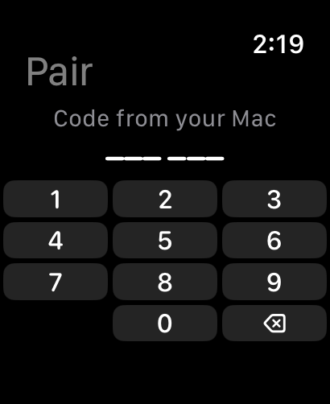

# Claude Watch

Control the [Claude Code](https://claude.com/claude-code) sessions on your Mac from your Apple Watch.

- **See your sessions**: which are busy, open on the Mac, idle, or waiting on you.
- **Talk to them**: dictate a message to any session, including the ones open in the Claude
  desktop app or a terminal. Replies come back short enough to read on a watch, or the watch
  reads them aloud.
- **Get told when one needs you**: an alert the moment a session asks a question or shows a
  permission prompt. The answers are buttons on the alert.
- **Get told when it's done**: an alert with the last reply when a long task finishes.
- **Watch face complications**: who needs you, how many sessions are working, and how much of
  your Claude usage limit is spent.

> Unofficial. Not made or supported by Anthropic.



## How it works

```
Apple Watch app ──HTTPS──▶ relay (Cloudflare Worker) ◀──WebSocket── bridge on your Mac
       ▲                     │  passes encrypted requests;            │ reads ~/.claude/projects
       └── Apple push ◀──────┘  sends alerts                          │ runs and relays to claude
```

- **`bridge/server.mjs`** runs on your Mac. Plain Node, no dependencies.
  - It reads Claude Code's session transcripts, sends messages with the `claude` command line, and
    watches for sessions that need you.
  - It connects *out* to the relay, so your Mac needs no open port, tunnel or domain.
- **`relay/`** is a small Cloudflare Worker that passes messages between watches and Macs.
  - Watch and Mac agree on a key when you pair, so requests and replies are encrypted end to end.
    The relay can't read them.
  - It holds the Apple push key and sends the alerts.
- **`ClaudeWatch/`** is the watchOS app (SwiftUI, no iPhone app needed) with its complications.

[docs/ARCHITECTURE.md](docs/ARCHITECTURE.md) has the details.

## Requirements

- A Mac with [Claude Code](https://claude.com/claude-code) (the desktop app or the CLI) and
  Node 22 or later.
- An Apple Watch on watchOS 26 or later.
- Until the app is on the App Store, you also need Xcode 26+ and an Apple Developer account to
  install it (see [Building the app yourself](#building-the-app-yourself)).

## Setting it up

**Using Claude Code?** Open this folder in Claude Code and say *"set this up for me"*. The steps
for agents are in [AGENTS.md](AGENTS.md).

By hand, from the repository folder:

1. **Install the bridge.** It runs at login and restarts if it stops.

   ```bash
   bridge/install-agents.sh
   ```

2. **Sign it in to Claude** (once). The desktop app's sign-in isn't shared with the command line.

   ```bash
   claude-watch login
   ```

3. **Pair your watch.** Run this, then on the watch tap **Pair with your Mac**, enter the 6-digit
   code, and check that both show the same check number before typing `y`.

   ```bash
   claude-watch pair
   ```

4. **Add the complications** (optional). Long-press your watch face, tap Edit, and choose
   **Claude sessions** or **Claude usage** for a slot.

Allow notifications when the app asks. Alerts then arrive through the relay.

`claude-watch unpair` forgets paired watches. `bridge/install-agents.sh uninstall` removes the
bridge.

## Using it

- **Sessions list**: the bar beside each session shows its state: orange needs you, green busy,
  blue open on the Mac, gray idle.
- **In a session**: the mic button dictates a message, and the speaker button reads the last
  reply aloud. When Claude offers choices, they show as buttons.
- **New session**: starts one in `~/.claude-watch/workspace`. Say *"Tell harness to run the
  tests"* to message the session whose project folder or title is "harness" instead.
- **Alerts**: tap an answer button, or Reply, on a "needs you" alert. Permission prompts can only
  be answered on the Mac.

### Messages to sessions open on your Mac

A session open in the Claude desktop app or a terminal gets your message delivered into it, using
Claude Code's session-to-session messaging. It answers in its own conversation, so you see the
exchange on the Mac too. Notes:

- The message arrives labelled as relayed from your watch, not as typed by you.
- A busy session reads it between steps.
- A running Mac session can't be stopped from the watch.

Sessions that aren't open anywhere are resumed headless by the bridge instead.

## Building the app yourself

Until the app is on the App Store:

1. Put in your Apple team ID (developer.apple.com → Membership) and a bundle prefix you own:

   ```bash
   node bridge/server.mjs configure --team ABCDE12345 --bundle-prefix com.yourname.claudewatch
   ```

   This writes `ClaudeWatch/Local.xcconfig`, which git ignores.

2. Sign in to Xcode (Settings → Apple Accounts), and turn on Developer Mode on the watch
   (Settings → Privacy & Security).

3. Open `ClaudeWatch/ClaudeWatch.xcodeproj`, choose the **ClaudeWatch** scheme and your watch, and
   press Run.

With your own bundle ID, the shared relay can't send your build alerts, because Apple ties push
keys to the publisher's apps. Everything else works. For alerts, run your own relay; see
[relay/README.md](relay/README.md).

### Without a relay

You can also reach the bridge directly through your own HTTPS tunnel, such as a Cloudflare Tunnel
to `http://localhost:8787`. Enter the address, and the token from `~/.claude-watch/token`, under
the watch app's Settings → Direct connection. For alerts in this mode, the bridge needs your own
push key: run `node bridge/server.mjs push` with the `AuthKey_….p8` in Downloads.
`install-agents.sh` also runs a Cloudflare tunnel named `claude-watch` at login, if you have one.

## Configuration

Environment variables for the bridge. Set them in the `EnvironmentVariables` of
`~/Library/LaunchAgents/local.claudewatch.bridge.plist`, or export them before running it.

| Variable | Default | What it does |
| --- | --- | --- |
| `BRIDGE_PORT` | `8787` | Port on 127.0.0.1 |
| `BRIDGE_PERMISSION_MODE` | Claude's default | `claude --permission-mode` for headless watch messages, e.g. `acceptEdits` |
| `BRIDGE_NEW_CWD` | `~/.claude-watch/workspace` | Folder for sessions started from the watch |
| `BRIDGE_LIVE_MODE` | `relay` | `copy` answers sessions open on the Mac from a fork instead |
| `BRIDGE_DONE_MIN_SECONDS` | `45` | Shortest turn at the Mac that gets a "done" alert |
| `BRIDGE_KEEP_AWAKE` | on | `0` lets the Mac sleep while plugged in |
| `BRIDGE_RELAY` | the shared relay | Relay used by `claude-watch pair` |
| `TUNNEL_NAME` | `claude-watch` | Cloudflare tunnel for a direct connection, read by `install-agents.sh` |
| `CLAUDE_BIN` | found automatically | Path to the `claude` binary |

After editing `bridge/server.mjs`, run `bridge/install-agents.sh` again to restart the bridge.

## Security and privacy

A paired watch can run Claude on your Mac, so treat it like remote access. In short:

- Requests and replies between watch and Mac are encrypted end to end. Pairing needs a one-time
  code *and* your confirmation of matching check numbers, so the relay can't swap the keys.
- **Alert text passes through the relay unencrypted**: the session title and question, or the
  start of the last reply. Apple's push service needs readable alert text.
- `claude-watch unpair` cuts a watch off at once.

More in [SECURITY.md](SECURITY.md).

## Troubleshooting

| Symptom | Likely cause |
| --- | --- |
| "Your Mac isn't connected" | The Mac is asleep (on battery, or the lid is closed), or the bridge isn't running. Check `~/.claude-watch/logs/bridge.log` for `relay: connected`. |
| "Bridge is not signed in" | Run `claude-watch login`. |
| "That code isn't valid" | Codes work once, for 10 minutes. Run `claude-watch pair` again. |
| "no longer paired" | The Mac unpaired the watch. Pair again. |
| No alerts | Allow notifications for the app on the watch (Settings → Notifications), then reopen it so it signs up again. |
| Xcode "No Accounts" or a profile error | Sign in under Xcode → Settings → Apple Accounts, quit and reopen Xcode, then build again. |
| Install fails with "profile cannot be installed" | A stale wildcard profile without your watch. Remove it from `~/Library/Developer/Xcode/UserData/Provisioning Profiles` and build again. |

Bridge logs are in `~/.claude-watch/logs/`.

## Contributing

See [CONTRIBUTING.md](CONTRIBUTING.md). MIT licensed; see [LICENSE](LICENSE).
